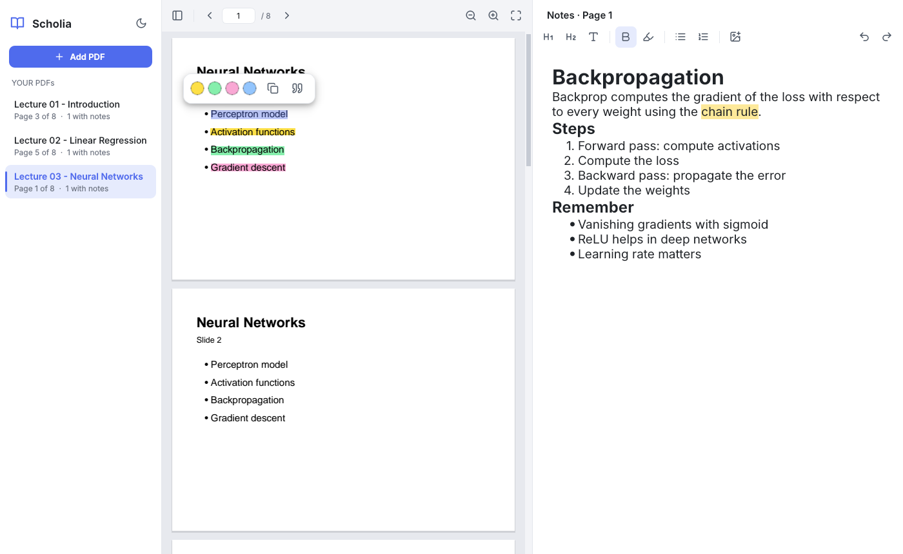
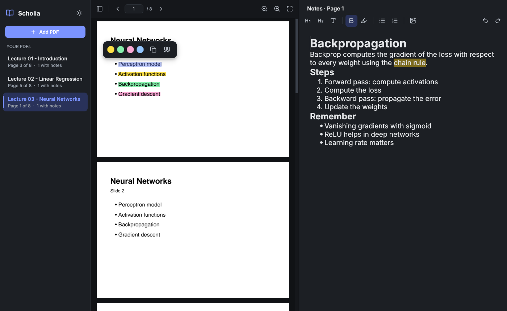

<div align="center">


# Scholia

**Read lecture PDFs and write your own notes for every page, side by side.**

A fast, private desktop app for students: your PDF on the left, a rich note page for the *current* PDF page on the right. Everything is saved automatically and stays on your computer.




</div>

---

## About the name

*Scholia* (singular *scholium*) are the notes scholars wrote in the margins of manuscripts to explain and expand the text. That is exactly what this app is for: your own explanations, written next to the original page.

## Why Scholia?

Lecture slides are short on purpose: a few bullet points, no explanations. The real understanding lives in what *you* add: your own wording, extra details, screenshots, and examples.

Scholia gives every PDF page its own linked note page, so the slide and your explanation are always next to each other. Flip to page 12 and your notes for page 12 appear. No more juggling a PDF viewer and a separate notes app.

## Features

**Reading**
- Continuous PDF view with zoom in / out / fit-to-width
- Jump to any page by typing its number; step with the arrow buttons or the keyboard
- Resizable split view: drag the divider to give the PDF or the notes more space

**Highlighting (directly on the PDF)**
- Select text by dragging, or double-click a word, and a small bar appears
- Highlight in four colors, copy the text, or send it to your notes as a quote with one click
- Click a highlight to change its color, copy it, or remove it
- Highlights are saved automatically and come back when you reopen the PDF

**Notes (one linked page per PDF page)**
- Rich text: title, heading, normal text, **bold**, highlight, bullet and numbered lists, nested lists
- Paste screenshots straight from the clipboard (`Cmd+Shift+4`, then `Cmd+V`) or insert images from a file
- Markdown-style shortcuts: type `- ` for a bullet list, `1. ` for a numbered list, `# ` for a title, `## ` for a heading
- Undo / redo, and automatic saving (no Save button)

**Library for many PDFs**
- Add several PDFs at once and switch between them with one click
- The list is remembered between launches; removing a PDF from the list never deletes your file or notes
- Each entry shows where you stopped and how many pages have notes, e.g. *Page 12 of 40 · 8 with notes*
- Drag and drop PDFs onto the window to add them
- Reopens your last PDF on the page you left

**Design**
- Clean modern interface with vector icons
- Light and dark themes (follows your system on first launch, one click to switch)
- Remembers window size and panel layout

## Screenshots

| Light | Dark |
|:---:|:---:|
|  |  |

## Installation

### Option 1: Download the app (macOS)

1. Download `Scholia-<version>-macos.zip` from the [latest release](../../releases/latest).
2. Unzip it and drag **Scholia.app** into your **Applications** folder.
3. Open it. On first launch macOS may warn that the app is from an unidentified developer; see [Troubleshooting](#troubleshooting).

### Option 2: Run from source

Requires **Python 3.10+**.

```bash
git clone https://github.com/<your-username>/Scholia.git
cd Scholia

python3 -m venv .venv
source .venv/bin/activate
pip install -r requirements.txt

python3 Scholia.py
```

### Option 3: Build the macOS app yourself

```bash
pip install pyinstaller
bash tools/build_macos.sh
```

The script cleans old build files, builds with the app icon, and creates `dist/Scholia.app`. Drag it into **Applications**.
The equivalent manual command is `pyinstaller --windowed --noconfirm --name "Scholia" --icon assets/Scholia.icns Scholia.py`.

## Usage

1. Click **Add PDF** (or press `Cmd+O`, or drag PDFs into the window).
2. Pick a PDF in the left list. It opens on the page where you stopped last time.
3. Write your notes on the right. Move to another page and the notes for that page appear.
4. Close the app whenever you like. Everything is already saved.

### Keyboard shortcuts

| Action | Shortcut |
|---|---|
| Add PDF(s) | `Cmd+O` |
| Previous / next page | `Cmd+[` / `Cmd+]` |
| Previous / next page (PDF focused) | `←` / `→` |
| Show / hide PDF list | `Cmd+\` |
| Title / Heading / Normal text | `Cmd+Option+1` / `2` / `0` |
| Bold | `Cmd+B` |
| Highlight | `Cmd+Shift+H` |
| Undo / Redo | `Cmd+Z` / `Cmd+Shift+Z` |
| Paste screenshot | `Cmd+V` |
| Copy selected PDF text | `Cmd+C` |
| Clear the PDF selection | `Esc` |
| Indent / outdent list item | `Tab` / `Shift+Tab` |
| Remove selected PDF from list | `Delete` (while the list is focused) |

### Writing faster with typing shortcuts

| Type | Result |
|---|---|
| `- ` or `* ` at the start of a line | Bullet list |
| `1. ` at the start of a line | Numbered list |
| `# ` at the start of a line | Title |
| `## ` at the start of a line | Heading |

## Where your data lives

Scholia keeps everything in plain files next to your PDF. There is no account, no cloud, and no network access.

```
Lecture 03.pdf
Lecture 03_notes/
├── notes.json        # notes for each page, highlights, and your last position
└── images/           # screenshots and images used in your notes
    └── 3f9a1c2b7d10.png
```

- **Back up** your notes by copying the `*_notes` folder.
- **Move or rename** a PDF together with its `*_notes` folder (the folder name must stay `<pdf name>_notes`) and the notes follow it.
- The list of PDFs and window layout are stored in the standard macOS preferences for the app.

## Project structure

```
Scholia/
├── Scholia.py          # the whole application
├── requirements.txt
├── assets/             # app icon (Scholia.icns for macOS, Scholia.png)
├── tools/make_icon.py  # regenerates the icon (needs PySide6 and Pillow)
├── tools/build_macos.sh # one-command macOS build with the icon
├── docs/screenshots/   # images used in this README
├── RELEASE_NOTES.md
├── LICENSE
└── README.md
```

## Troubleshooting

**macOS says the app can't be opened because the developer cannot be verified.**
The app is not signed with an Apple Developer certificate. Either right-click **Scholia.app**, choose **Open**, and confirm, or open **System Settings → Privacy & Security** and click **Open Anyway**. If it still refuses, run this once in Terminal:

```bash
xattr -cr /Applications/Scholia.app
```

**`pyinstaller` fails with "The 'pathlib' package is an obsolete backport".**
An old `pathlib` package is installed in your environment. Remove it and build again:

```bash
python3 -m pip uninstall pathlib
```

**The built app shows a generic icon instead of the Scholia icon.**
Rebuild with `bash tools/build_macos.sh` (it removes stale `build/`, `dist/` and `.spec` files, which can keep old settings). If the icon is correct inside the bundle but Finder or the Dock still show the old one, macOS is caching it: run `touch dist/Scholia.app && killall Finder Dock`, or move the app to **Applications** again.

**A PDF in the list is greyed out or says "File not found".**
The file was moved or deleted. Remove it from the list and add it again from its new location. Its notes folder is untouched.

**My notes disappeared after I renamed a PDF.**
Notes are linked by file name. Rename the `<pdf name>_notes` folder to match the new PDF name.

**The built app does not start.**
Run the binary directly to see the error message:

```bash
"dist/Scholia.app/Contents/MacOS/Scholia"
```

## Known limitations

- Notes are linked to PDFs by file name and location (see above).
- Highlights are stored in Scholia's own files and do not change the PDF, so other PDF apps will not show them.
- Text selection needs a PDF with real text. Scanned pages (images of text) cannot be selected.
- Highlights follow page positions, so if you replace a PDF with a different version they may no longer line up.
- PDF pages stay white in dark theme; only the app interface is themed.
- No full-text search across notes and no export (PDF / Markdown) yet.
- The macOS build is unsigned and not notarized.
- Developed and tested on macOS. Because it is built on PySide6 it should run on Windows and Linux, but those platforms are untested and keyboard shortcuts use macOS conventions.

## Roadmap

- Search across all notes and PDF text
- Export notes (Markdown / PDF), and export the PDF with your highlights
- A list of all highlights per PDF
- Signed and notarized macOS builds
- Per-page tags and bookmarks

Ideas and bug reports are welcome; see below.

## Contributing

1. Fork the repository and create a branch: `git checkout -b feature/my-change`
2. Make your change and run the app to check it works: `python3 Scholia.py`
3. Commit with a clear message and open a pull request describing what and why.

When reporting a bug, please include your macOS version, Python and PySide6 versions, and the steps to reproduce.

## License

Released under the [MIT License](LICENSE).

## Author

Created by **Fakrul Islam**.

Built with [Python](https://www.python.org/) and [Qt for Python (PySide6)](https://doc.qt.io/qtforpython-6/). Icon designs are based on [Lucide](https://lucide.dev/) (ISC License).
